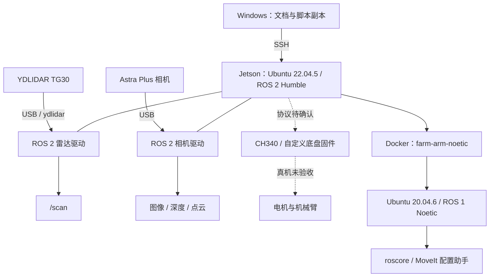

# 架构与代码地图

更新：2026-10-17｜适用：本项目本地资料、Jetson 宿主机与 Noetic 教程容器。
依据：2026-10-11 设备记录，以及2026-10-17 本地脚本静态阅读；本次未复查设备或部署版本。

## 1. 系统边界

实线仅表示已记录的连接或软件关系，不代表此刻正在运行。虚线部分未完成控制验收。Noetic 教程容器使用 `network none`，未映射硬件控制设备；目前无已验证的 ROS 1／ROS 2 桥接链路。X11 只负责显示，不建立机器人控制通路。

系统与接线参数以[硬件环境](environment/hardware.md)与[软件环境](environment/software.md)为主；教程容器以[机械臂专题](guides/arm.md)为主。

## 2. 本地与设备代码定位

本地设备相关实现目前只有一个教程脚本，此外保存文档、资料原件和文档维护工具；没有已归档的整套机器人源码或自定义固件。以下远端路径来自历史记录，目录存在性和部署版本需在开发时复核。

| 位置 | 对象与职责 | 版本／验证状态 |
|---|---|---|
| 本地 [modules/arm/arm-noetic.sh](../modules/arm/arm-noetic.sh) | 教程容器创建、启动、命令转发、停止 | 2026-10-17 阅读；未执行；当前与设备副本一致性未复核 |
| Jetson `/home/jetson/farm-tools/arm-noetic.sh` | 上述脚本部署入口 | 2026-10-11 部署与 `core` 实测；未记录部署哈希 |
| Jetson `/home/jetson/.bashrc` | 环境加载与车型、雷达、相机变量 | 变更及备份见软件环境文档 |
| Jetson `/home/jetson/yahboomcar_ros2_ws/software/library_ws` | 原厂库工作空间；传感器依赖入口 | 安装环境路径已记录；各包源码子路径与提交待定位 |
| Jetson `/home/jetson/yahboomcar_ros2_ws/yahboomcar_ws` | 原厂机器人应用工作空间 | `laser_bringup_launch.py` 的 x3plus 分支缺失；绝对文件路径待定位 |
| Jetson `/home/jetson/Rosmaster` | 原厂库示例资料 | 历史记录 Rosmaster_Lib 3.3.1；自定义固件兼容性未知 |
| 容器 `/root/yahboomcar_ws/src/x3plus_moveit_config` | 预装 MoveIt 配置 | 2026-10-11 确认存在，未验收真机配置 |
| 容器 `/root/yahboomcar_ws/src/yahboomcar_description/urdf/yahboomcar_X3plus.urdf` | X3 Plus 模型 | 路径存在已记录，模型加载与实物一致性未验证 |
| 容器 `/root/software/library_ws/devel/setup.bash` | ROS 1 库环境加载入口 | 本地脚本引用；依赖版本需后续归档 |
| 自定义底板固件 | 控制协议、反馈、停止与执行器控制 | 源码位置、版本、构建与烧录方法均待归档 |

教程脚本按 `mode` 分派 `start/shell/core/setup/stop`；非 `stop` 模式下，容器不存在时创建，存在时核对用途标签，再按需启动。`core` 执行 `roscore`；`setup` 执行 MoveIt 配置助手；`stop` 直接停止同名容器，位于标签检查之前。脚本不是整车驱动入口。

持久数据映射：Jetson `/home/jetson/farm-arm-data` ↔ 容器 `/root/farm_data`（按 `jetson` 用户执行时）；脚本实际源路径采用 `$HOME/farm-arm-data`。换用户执行会改变路径，不能直接照搬同一部署假设。

## 3. 已知接口与缺口

| 接口 | 生产者 → 消费者 | 已记录内容 | 编程前还需核对 |
|---|---|---|---|
| `/scan` | `ydlidar_ros2_driver` → 感知／可视化订阅端 | LaserScan；`frame_id=laser`；短时 10.15 Hz | 完整消息类型、QoS、时间戳语义、安装外参 |
| `/camera/color/image_raw` | `astra_camera` → 图像订阅端 | Image；rgb8；640×480 | 完整类型、QoS、时间同步、相机坐标 |
| `/camera/depth/image_raw` | `astra_camera` → 深度订阅端 | Image；16UC1；640×480 | 深度数值单位、无效值规则、RGB 对齐 |
| `/camera/ir/image_raw` | `astra_camera` → 图像订阅端 | Image；mono8 | QoS、坐标、同步 |
| `/camera/depth/points` | `astra_camera` → 点云订阅端 | PointCloud2，收到连续消息 | fields、坐标、单位、几何精度 |
| 各路 `camera_info` | 相机驱动 → 标定信息消费者 | CameraInfo；连续发布、内参非零 | 标定来源、畸变模型、与图像一致性 |
| `/dev/myserial` | Jetson ↔ 自定义底板 | CH340 USB 映射已确认；原厂 115200 查询无应答 | 实际波特率、帧格式、校验、命令、反馈、超时与停止 |
| `map → odom → base_link → 传感器` | 待确定 | 目标整车 TF 关系，尚未验证 | 各变换发布者、轴方向、单位、外参与更新频率 |

原厂查询所用波特率不等于自定义固件已确认波特率；不能根据话题命名假定完整接口。上表仅为已有记录摘要，尚不是可直接实现底盘驱动的完整契约。速度控制入口、里程计和机械臂控制话题均未确认。

## 4. 修改定位与验证入口

| 任务 | 先读／定位 | 最小验证范围 |
|---|---|---|
| 传感器启动问题 | 软件环境与传感器指南，对应驱动 launch 与参数文件 | 单设备启动、数据、停止；参数变化后回归 |
| Noetic 教程入口 | 本地脚本、机械臂专题、设备副本差异 | 脚本语法、容器边界、master、图形分别验证 |
| X3 Plus 整车适配 | 真实启动文件、机器人模型、底盘库及固件契约 | 配置加载、反馈、运动与停止分阶段验收 |
| 底盘协议开发 | 固件源码、协议、板卡版本先归档 | 离线编解码与异常帧，再按条件验证硬件 |

当前无统一的本地构建／测试／部署命令可供整车代码使用；建立真实源码入口后再补充。AI 每次修改应记录本地版本与设备部署版本，未部署或未复测必须明确说明。

本地模块入口见[modules](../modules/README.md)。农场旋耕与 RTK 的[设计设想](plans/farm-workflow.md)尚未与本图的设备架构建立已确认关系。
